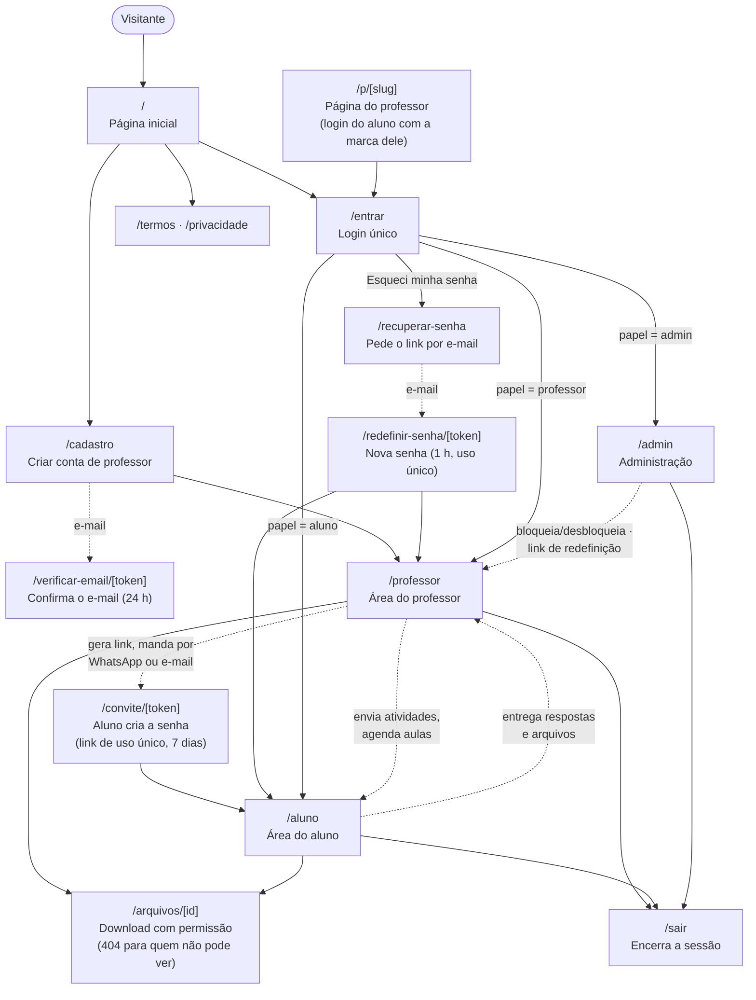
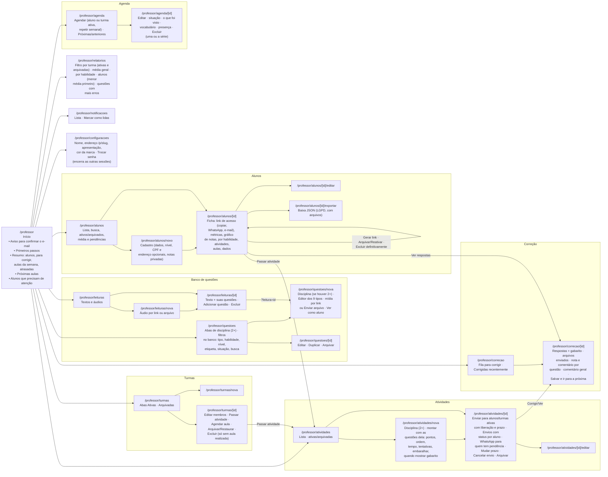
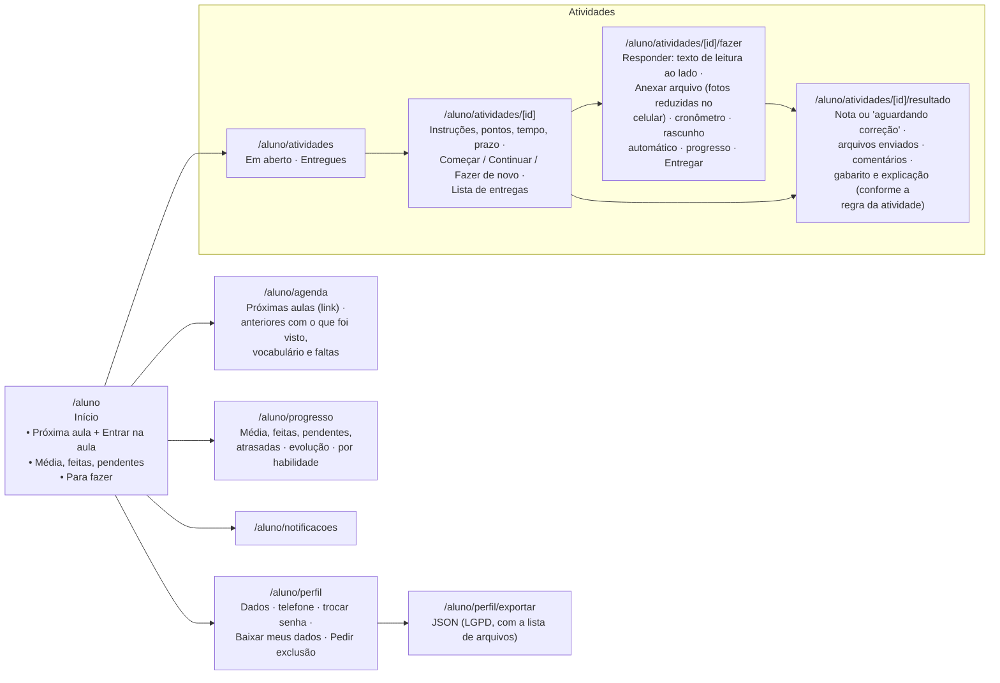
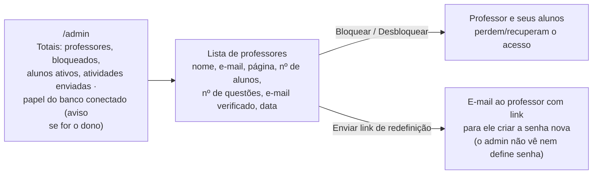
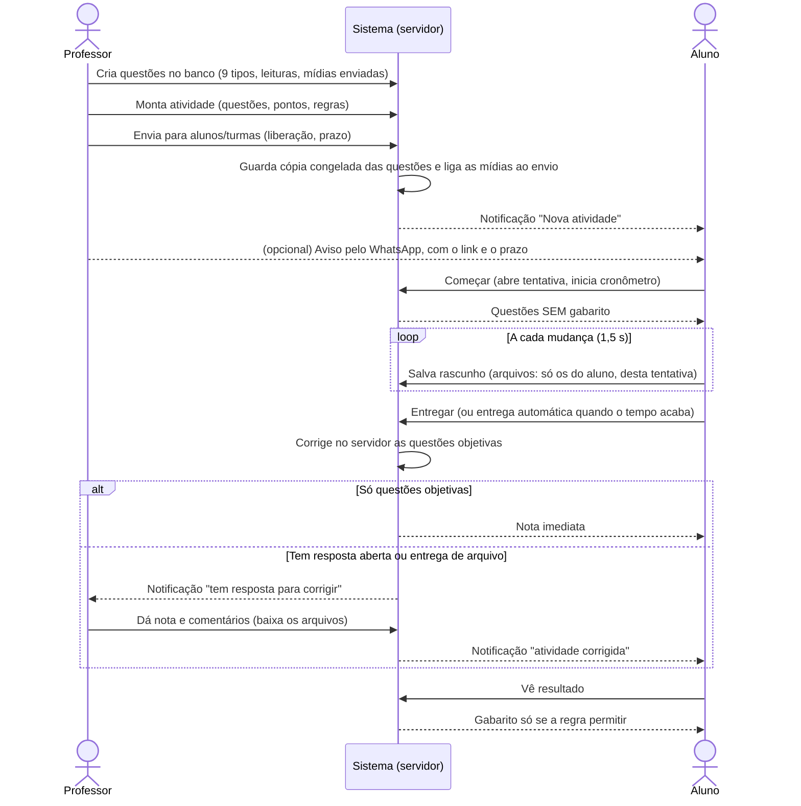
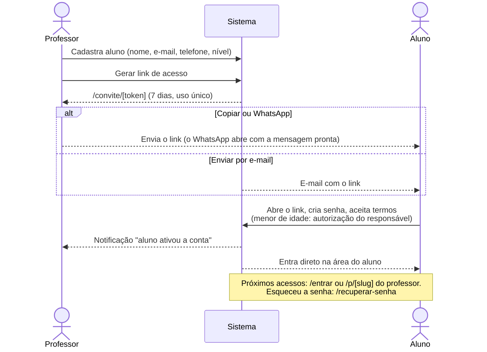
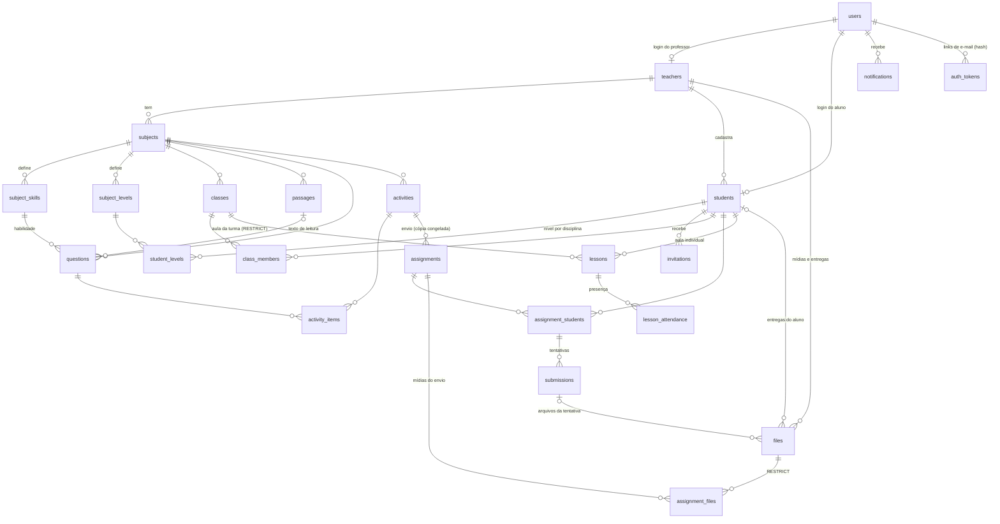

# Diagrama do sistema Docentia: telas e funções

O projeto começou como o protótipo "Teacher Sarah"; a plataforma agora se chama Docentia.

Estado em 26/10/2026: em produção com a Fase 1 (PostgreSQL e disciplinas); a Fase 2 (turmas arquivadas, desempenho, e-mail, WhatsApp, upload de arquivos e papel do banco com login próprio) está no pull request da branch `fase2` e já aparece nestes diagramas. Eles usam Mermaid e aparecem desenhados no GitHub e em editores com suporte a Mermaid.

## 1. Visão geral: áreas e acesso

Três perfis entram pela mesma tela de login e cada um cai na sua área. As rotas privadas exigem sessão; os dados de cada professor ficam isolados.



## 2. Área do professor



## 3. Área do aluno



## 4. Área do administrador



## 5. Ciclo de uma atividade



## 6. Entrada do aluno



## 7. Tabelas e relações

Toda tabela com `teacher_id` tem RLS forçada, e as chaves estrangeiras entre elas incluem `teacher_id`. As tabelas globais (`users`, `teachers`, `invitations`, `notifications`, `auth_tokens`, `rate_limits`, `app_meta` e a antiga `login_attempts`, que não é mais usada) não têm dono de professor.



## 8. Uma consulta do app, passo a passo

Toda consulta passa por `withScope`. O início da transação vai numa ida só ao banco: assume o papel `app_user` (sem BYPASSRLS) e define o contexto que a RLS usa.

```mermaid
sequenceDiagram
    participant Tela as Página ou Server Action
    participant Repo as withScope (repo.ts)
    participant Ctx as contextLiteral (context-sql.ts)
    participant PG as PostgreSQL (Neon, pooler)

    Tela->>Repo: withScope(professor ou aluno, fn)
    Repo->>Ctx: valida uuid / "on" / identificador
    Ctx-->>Repo: literais seguros (ou erro, sem conectar)
    Note over Repo,PG: Conexão como app_login (DATABASE_APP_URL),<br/>que sozinho não lê nenhuma tabela
    Repo->>PG: BEGIN; SELECT set_config('role','app_user',true),<br/>set_config('app.teacher_id' / 'app.student_id', ..., true)
    Repo->>PG: consultas de fn, em sequência (SQL com parâmetros)
    PG-->>Repo: só as linhas que as políticas de RLS liberam
    alt tudo certo
        Repo->>PG: COMMIT
    else erro em qualquer passo
        Repo->>PG: ROLLBACK (nada fica gravado pela metade)
    end
    Repo-->>Tela: resultado
    Note over Repo,PG: set_config(..., true) vale só nesta transação, por isso funciona<br/>com o PgBouncer do Neon. Um RESET ROLE volta para app_login, não para o dono.
```

## 9. Recuperação de senha

```mermaid
sequenceDiagram
    actor U as Pessoa
    participant Sis as Sistema
    participant DB as Banco
    participant Mail as E-mail (SMTP)

    U->>Sis: /recuperar-senha (e-mail)
    Sis->>DB: conta pedido por IP e por e-mail (rate_limits)
    alt passou do limite (3 por e-mail / 10 por IP, por hora)
        Sis-->>U: "Muitos pedidos"
    else dentro do limite
        Sis->>DB: se a conta existe: invalida links antigos, grava o hash do novo (1 h)
        Sis-->>U: Mesma resposta, exista ou não a conta
        Sis->>Mail: envia o link depois da resposta (after)
    end
    U->>Sis: /redefinir-senha/[token] + nova senha
    Sis->>DB: gasta o token (uso único), grava a senha,<br/>sobe a versão da sessão, confirma o e-mail
    Sis-->>U: Sessão nova; as outras sessões da conta caem
```

## 10. Envio e download de arquivo

```mermaid
sequenceDiagram
    actor Al as Aluno (ou professor)
    participant Nav as Navegador
    participant Sis as Servidor
    participant DB as Banco (RLS)
    participant Arm as Armazenamento (Blob privado)

    Al->>Nav: Escolhe o arquivo
    Nav->>Nav: Foto: reduz para 1600 px (WebP/JPEG)
    Nav->>Sis: Pede o envio (nome, tipo, tamanho, questão)
    Sis->>DB: confere tentativa aberta, questão, tipo, tamanho e limite;<br/>cria a linha "pending"
    Sis-->>Nav: Autorização só para esta chave, este tipo e este tamanho (10 min)
    Nav->>Arm: Envia direto ao armazenamento
    Nav->>Sis: Confirma
    Sis->>Arm: head: tamanho e tipo reais
    alt confere
        Sis->>DB: marca "ready"
    else não confere
        Sis->>DB: apaga a linha
        Sis->>Arm: apaga o objeto
    end
    Al->>Sis: /arquivos/[id]
    Sis->>DB: busca o arquivo no escopo de quem pede
    alt pode ver
        Sis-->>Al: redireciona para URL assinada de 5 min
    else outro aluno, outro professor ou sem login
        Sis-->>Al: 404
    end
```
