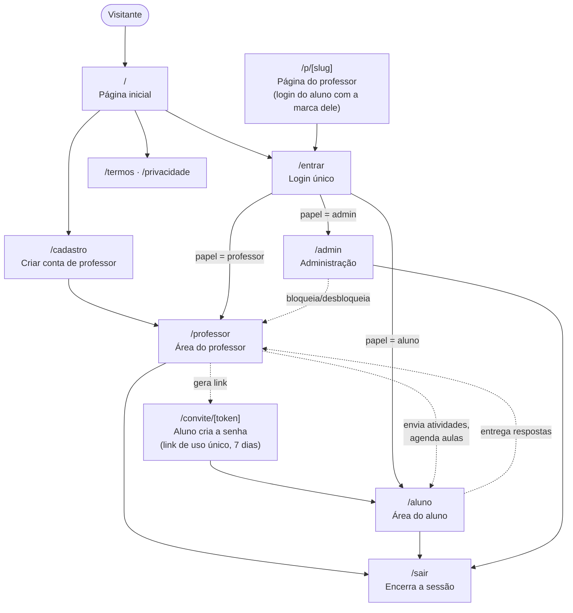
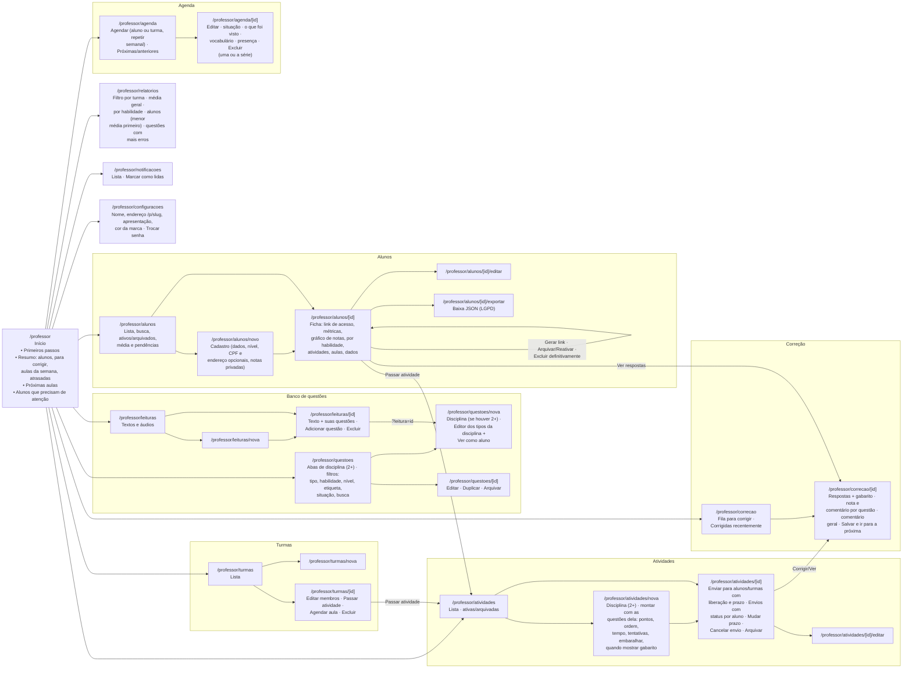
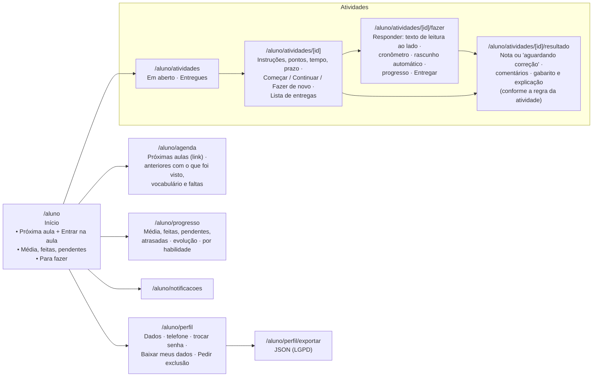
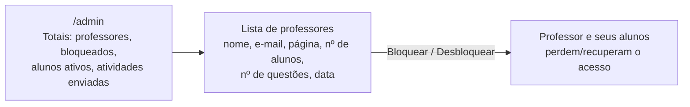
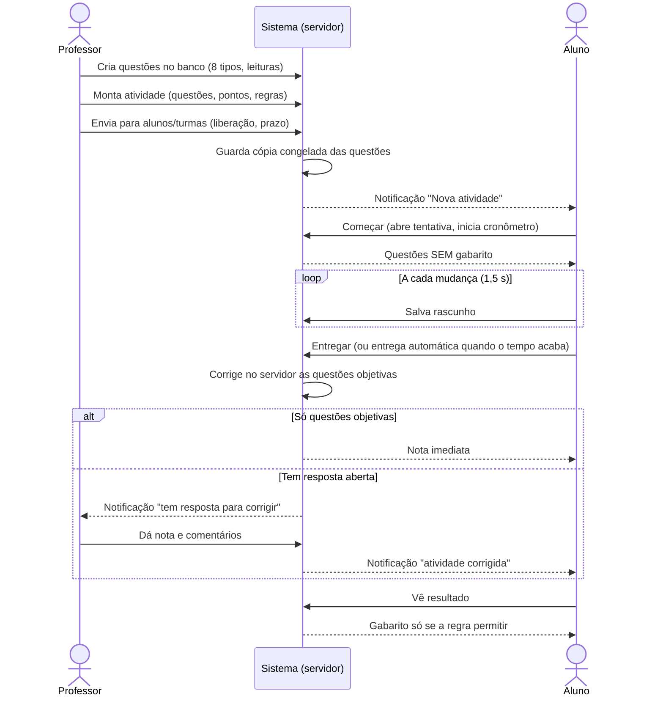
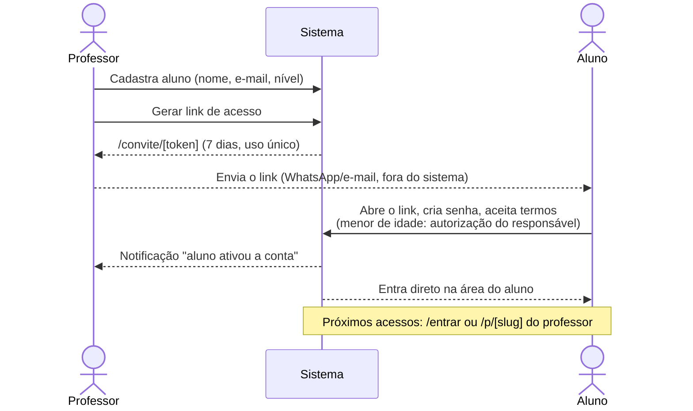
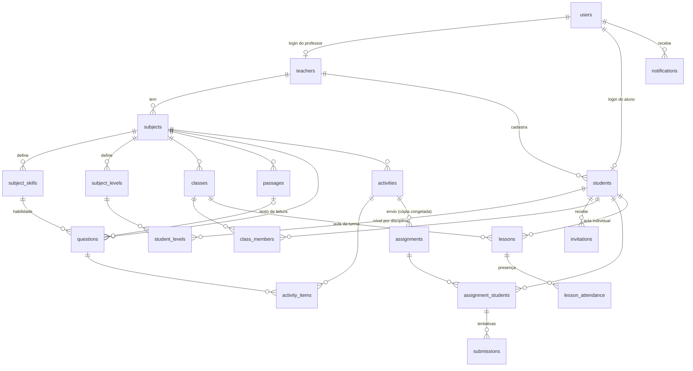
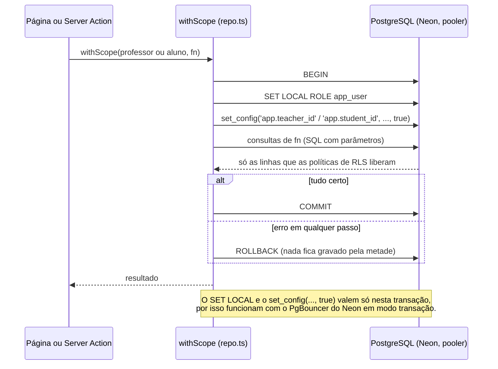

# Diagrama do sistema Docentia: telas e funções

O projeto começou como o protótipo "Teacher Sarah"; a plataforma agora se chama Docentia.

Estado em 26/10/2026 (em produção, com a Fase 1: PostgreSQL e disciplinas). Os diagramas usam Mermaid e aparecem desenhados no GitHub e em editores com suporte a Mermaid.

## 1. Visão geral: áreas e acesso

Três perfis entram pela mesma tela de login e cada um cai na sua área. As rotas privadas exigem sessão; os dados de cada professor ficam isolados.

## 2. Área do professor

## 3. Área do aluno

## 4. Área do administrador

## 5. Ciclo de uma atividade

## 6. Entrada do aluno

## 7. Tabelas e relações

Toda tabela com `teacher_id` tem RLS forçada, e as chaves estrangeiras entre elas incluem `teacher_id`. As tabelas globais (`users`, `teachers`, `invitations`, `notifications`, `login_attempts`, `app_meta`) não têm dono de professor.

## 8. Uma consulta do app, passo a passo

Toda consulta passa por `withScope`. Dentro da transação, o papel é `app_user` (sem BYPASSRLS), e o contexto define o que a RLS deixa ver.

